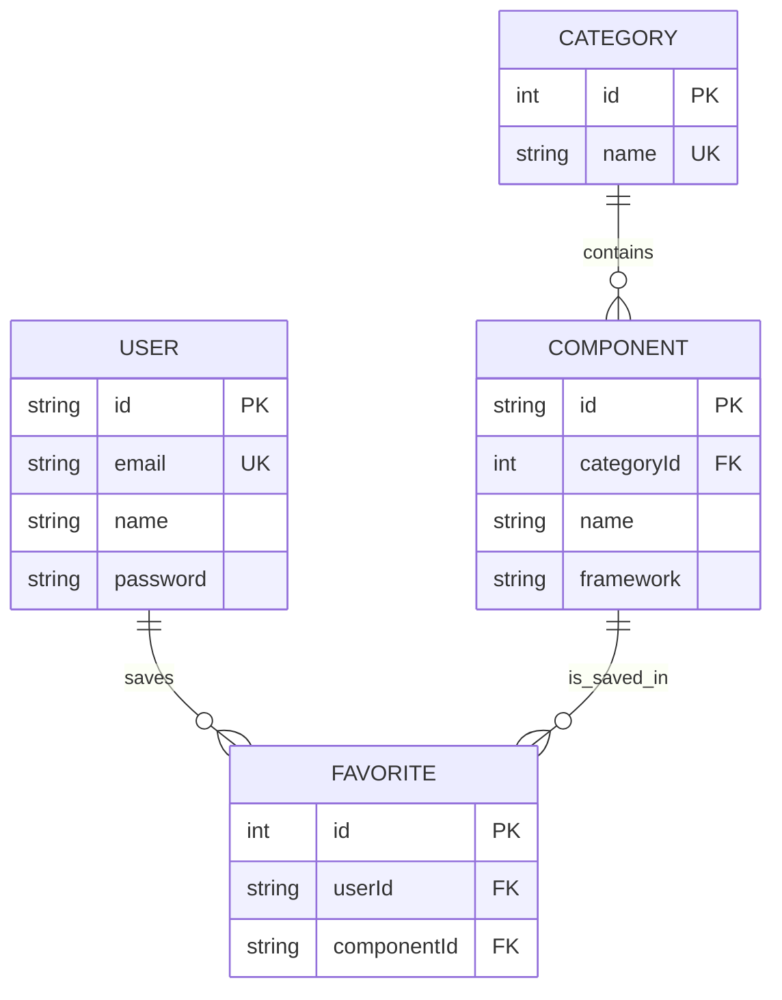

# NaTaUI — คลังไอเดีย UI สำหรับทุกคน

NaTaUI คือเว็บแอปภาษาไทยสำหรับค้นหา ทดลอง และเก็บตัวอย่าง UI Component เหมาะกับผู้เริ่มต้นที่อยากนำภาพและคำอธิบายไปให้ AI ช่วยต่อยอดเป็นเว็บไซต์จริง โปรเจกต์นี้จัดทำตามโจทย์ Mini Project 2 ในรูปแบบ Modern Decoupled SPA

## ฟีเจอร์หลัก

- คลังตัวอย่าง UI 21 รายการ 7 หมวดหมู่ พร้อมค้นหาและกรองตามรูปแบบ CSS/Tailwind CSS
- หน้ารายละเอียดพร้อม Preview แบบ sandboxed iframe, source code และปุ่มคัดลอก
- แคปภาพ Preview และคัดลอก Prompt สำหรับนำไปใช้อ้างอิงกับ AI
- My Collection ระบุตัวตนด้วยอีเมลแบบง่ายและบันทึกรายการโปรดแยกตามผู้ใช้ลง PostgreSQL
- หน้า Full-Stack CRUD สำหรับเพิ่ม แก้ไข และลบ Component ผ่าน Express REST API, Prisma ORM และ Supabase โดยข้อมูลหน้าเว็บไม่มี JSON fallback
- HTML/CSS Playground แก้โค้ดและดูผลลัพธ์แบบสด
- Loading, Error, Retry, Empty state และหน้า 404
- Responsive รองรับมือถือ แท็บเล็ต และเดสก์ท็อป

## เทคโนโลยี

React 19, Vite, TypeScript strict mode, React Router v7, TanStack Query v5, Zustand persist, Tailwind CSS, DaisyUI, Lucide React, Express 5, Prisma ORM 7 และ PostgreSQL

## ติดตั้งและเริ่มใช้งาน

ต้องมี Node.js 20 ขึ้นไปและ Supabase Project จากนั้นรัน:

```bash
npm install
```

คัดลอก `.env.example` เป็น `.env` แล้วแทน `[YOUR-PASSWORD]` ด้วย Database Password ของ Supabase จากนั้นนำ migration และข้อมูลตัวอย่างขึ้นฐานข้อมูล:

```bash
npm run prisma:deploy
npm run prisma:seed
npx prisma migrate status
```

เริ่ม Frontend และ Backend REST API พร้อมกัน:

```bash
npm run dev:all
```

หรือเปิดแยกสอง Terminal:

```bash
npm run api
npm run dev
```

- Frontend: `http://localhost:5173`
- Backend REST API: `http://localhost:3001/api`
- Prisma Studio: รัน `npm run prisma:studio`

## Routes

| Route | หน้า |
| --- | --- |
| `/` | Explore Components |
| `/components/:id` | Component Detail |
| `/collection` | My Collection |
| `/login` | Login แบบง่ายด้วยอีเมล |
| `/manage` | จัดการ Component แบบ Full-Stack CRUD |
| `/about` | About |
| `/playground` | Playground |

## API Endpoints

- `GET /api/health`
- `POST /api/auth/register`
- `POST /api/auth/login`
- `GET /api/components`
- `GET /api/components/:id`
- `POST /api/components`
- `PUT/PATCH /api/components/:id`
- `DELETE /api/components/:id`
- `GET /api/users/:userId/favorites`
- `POST /api/users/:userId/favorites`
- `DELETE /api/users/:userId/favorites/:componentId`

Relational schema อยู่ที่ `prisma/schema.prisma` และ migration อยู่ใน `prisma/migrations/` ประกอบด้วย `User`, `Category`, `Component` และ `Favorite` โดยมี PK/FK ครบ และตาราง `Favorite` ใช้ `@@unique([userId, componentId])` ป้องกันรายการซ้ำ ข้อมูลตัวอย่าง 21 รายการถูกนำเข้าผ่าน `prisma/seed.ts` จาก `server/db.json`

## Relational Model (ERD)



คู่ `(userId, componentId)` ใน `Favorite` เป็น compound unique ตาม `@@unique([userId, componentId])`

## Deploy บน Vercel

Vercel ใช้คำสั่ง `npm run build` และเผยแพร่โฟลเดอร์ `dist` สำหรับ Frontend ส่วน Backend ต้อง deploy เป็น Node.js service และตั้ง `VITE_API_URL` บน Vercel ให้ชี้ไป URL ที่ลงท้ายด้วย `/api` พร้อมตั้ง `DATABASE_URL`, `DIRECT_URL` และ `CLIENT_ORIGIN` บน Backend ให้ตรงกับ PostgreSQL/Supabase และโดเมน Frontend

### เชื่อม Supabase

คัดลอก `.env.example` เป็น `.env` แล้วแทน `[YOUR-PASSWORD]` ด้วย Database Password ของ Supabase Project โดยห้าม commit ไฟล์ `.env` ขึ้น Git หากรหัสผ่านมีอักขระพิเศษ เช่น `@`, `#`, `%`, `/` ต้องแปลงเป็น URL encoding ก่อน

- `DATABASE_URL` ใช้ transaction-mode pooler พอร์ต `6543` สำหรับ API runtime
- `DIRECT_URL` ใช้ session-mode pooler พอร์ต `5432` สำหรับ Prisma migration

นำ migration และข้อมูลตัวอย่างขึ้น Supabase:

```bash
npm run prisma:deploy
npm run prisma:seed
npx prisma migrate status
```

## การจัดการ State

- **TanStack Query** ดูแล Server State ได้แก่ Components, Favorites, mutations, cache, loading, error และ retry
- **Zustand + persist** ดูแล Client State เฉพาะ session ผู้ใช้ที่ login ไม่ทำสำเนา Components หรือ Favorites ลงใน store

## ตรวจสอบและ Build

```bash
npm run typecheck
npm run typecheck:server
npm run build
npm run preview
```

## ทีมผู้จัดทำ

หน้า About มี placeholder สำหรับสมาชิก 2–3 คน กรุณาแทนที่ชื่อเล่น ชื่อ–นามสกุล รหัสนักศึกษา และหน้าที่ด้วยข้อมูลจริงก่อนส่งงาน

## ภาพหน้าจอสำหรับส่งงาน

ภาพจากแอปที่รันจริงอยู่ใน `screenshots/hw3/` ครบทั้ง Explore, Detail, Login, Register, My Collection, Full-Stack CRUD, Playground, About และ Mobile ส่วนภาพ Supabase Table Editor และ Schema Visualizer อยู่ใน `screenshots/` ชื่อขึ้นต้นด้วย `w13act_`
